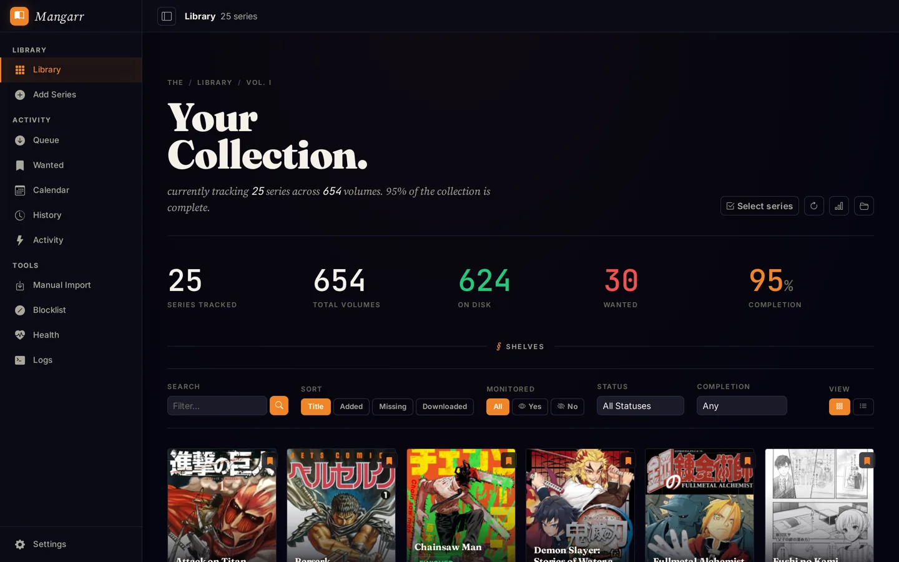

<div align="center">

# Mangarr

**Sonarr-style automation for manga and light-novel libraries.**

[](https://github.com/Kha-kis/manga-arr/releases/latest)
[](https://github.com/Kha-kis/manga-arr/pkgs/container/manga-arr)
[](https://www.python.org/)
[](LICENSE)

[Quick start](#quick-start) · [Features](#features) · [Documentation](#documentation) · [Support](SUPPORT.md)

</div>



Mangarr monitors manga and light-novel series, searches indexers and direct
download sources, sends releases to a download client, and imports completed
files into an organized library. It understands volumes, chapters, editions,
omnibuses, specials, and multi-volume packs instead of treating manga like a
generic TV or book collection.

**1.3.2 is the current published, qualified stable release.** It includes
durable NAS recovery, acquisition-policy protection, Suwayomi fixes, and
compressed-RAR decoding. See the
[qualification evidence and platform limits](docs/release-qualification.md#132-stable-qualification)
before upgrading.

**1.3.3-rc.9 is published but remains unqualified for stable promotion.** It includes the
managed Suwayomi-volume rescan correction and protects independent chapter
observations across download clients. No files are automatically removed.
Publication, scoped installed-image/workflow checks and a fresh full-day natural
metadata-repeat observation passed. Literal unchanged public Compose, native
ARM64 and representative NAS qualification remain gaps; RC9 results do not
qualify later changes on `master`. Production remains RC5 and qualified stable
remains 1.3.2. See
[RC9 qualification](docs/release-qualification.md#133-rc9-qualification).

**1.3.3-rc.8 is published but blocked from stable promotion.** It lacks the
missing-volume and independent-chapter corrections above. Its reviewed Suwayomi
chapter-provenance foundation does not enable automatic file cleanup. The
publication identity/attestation/security audit passed, but that does not waive
these defects or qualify a replacement. See
[RC8 qualification](docs/release-qualification.md#133-rc8-qualification).

**1.3.3-rc.7 is published as a prerelease, but remains unqualified.** It includes the
merged missing-loose-chapter and recorded custom-volume rescan corrections
([#445](https://github.com/Kha-kis/manga-arr/pull/445),
[#447](https://github.com/Kha-kis/manga-arr/pull/447)) and carries forward RC6's
automatic Suwayomi matching fix. Fresh local release gates and published-artifact
identity/attestation/security audit passed. Fresh core/cache/file/linkage and
automatic-match controls passed, alongside ten installed-image rescan regressions;
independent scoped audits are GO. A fresh real-provider automatic-match workflow
also downloaded eight chapters, imported a 254-page volume and passed ComicInfo,
content-hash and protected-state rescan checks. Its October 14-15 full-day
observation failed when an unattended Docker upgrade interrupted the observer.
Cleanup and protected-state checks passed, not the full-day gate. Remaining
environment/platform gates are also unqualified.
No earlier candidate's results qualify this replacement. Production
remains RC5 and stable aliases remain 1.3.2. See
[RC7 qualification](docs/release-qualification.md#133-rc7-qualification).

**1.3.3-rc.6 is published as a prerelease, but remains unqualified.** It carries
forward the reviewed RC5 fixes and [PR #440](https://github.com/Kha-kis/manga-arr/pull/440)'s
automatic Suwayomi matching correction. Fresh core/cache/file/linkage controls,
a real automatic-match/eight-chapter import/rescan workflow, and bounded natural
background coverage passed independent scoped audits. Full-day and remaining
environment/platform gates are still pending; no earlier candidate runtime
credit is inherited. Production remains on RC5 and stable
aliases on 1.3.2. See [RC6 qualification](docs/release-qualification.md#133-rc6-qualification).
The confirmed missing-loose-chapter and recorded custom-volume rescan defects
([#444](https://github.com/Kha-kis/manga-arr/issues/444),
[#446](https://github.com/Kha-kis/manga-arr/issues/446)) block stable approval.
Their source corrections are merged in [#445](https://github.com/Kha-kis/manga-arr/pull/445)
and [#447](https://github.com/Kha-kis/manga-arr/pull/447), but are not present in
the immutable RC6 image. A replacement candidate needs fresh qualification.

**1.3.3-rc.5 is published, with scoped audits GO, but remains unqualified.**
It contains PR #434's reviewed legacy MangaDex linkage and atomic-unlink fix.
Historical ambiguous aliases still require identity-backed manual review.
Fresh core/upgrade/rollback, cache, eleven loose-file controls, twelve provider-free
source-linkage cases and an eight-chapter download/import/rescan workflow passed
independent actual audit, as did the observed bounded short natural background
cycle. Full 86400-second coverage, representative NAS and
literal public Compose startup remain pending; no native ARM runtime credit is claimed.
No earlier candidate result supplies RC5 artifact credit.
See [RC5 qualification](docs/release-qualification.md#133-rc5-qualification).
Stable aliases remain on 1.3.2. An owner-controlled production trial now runs RC5
after a verified stopped backup; 48/48 smoke checks and six integration probes
passed. A new guarded production download also imported eight chapters into one
volume, verifying all 254 pages. This trial does not authorize stable promotion or
qualify other deployments.
Its automatic-match action has a confirmed SQLite-row `.get()` defect; the passing
production workflow used an explicit source link. RC6's source correction does not
change this immutable published image.

**1.3.3-rc.4 is published, but remains unqualified for promotion or deployment.**
It carries the reviewed RC3 fixes and PR #431's normal Suwayomi shutdown logging
correction. Fresh core/upgrade/rollback, cache and loose-file controls passed
independent audit, as did a NEW successful eight-chapter download/import/rescan
workflow. The short background run failed, and a known alternative-source restart
linkage defect remains in this image. Representative NAS, full natural 86400-second
coverage and literal public Compose startup remain pending; no native ARM runtime
credit is claimed. The linkage correction merged in
[PR #434](https://github.com/Kha-kis/manga-arr/pull/434) is for a future artifact,
not this published image. See
[RC4 qualification](docs/release-qualification.md#133-rc4-qualification).

**1.3.3-rc.3 is published but remains unqualified.** Scoped core/cache/loose-file
controls passed, and a fresh eight-chapter import had all 254 page hashes verified.
The overall workflow failed at rescan (a private harness CSRF omission) and normal
shutdown ERROR logging. See [RC3 results](docs/release-qualification.md#133-rc3-qualification).
Its immutable image is unchanged; the merged logging correction requires a new
candidate. At that qualification snapshot, production remained on RC1; the later
RC5 owner trial is recorded above. Source tests alone do not authorize deployment.

**The 1.3.3-rc.2 image is published, but qualification found release blockers.** It adds
loose-chapter preservation during volume deletion and recovery during rescan,
with conservative file identity and volume-alias checks. Follow
[RC2 qualification](docs/release-qualification.md#133-rc2-qualification)
for completed checks and the historical [deleted-volume alias failure](https://github.com/Kha-kis/manga-arr/issues/425).
RC2 is not cleared for promotion or deployment. Optional
duplicate-file cleanup is separate.

**1.3.3-rc.1 remains published as a release candidate, not a stable release.** It contains
further Suwayomi import/retry fixes, metadata retry and coverage corrections,
merged-volume ComicInfo enrichment, and a backup-age health fix. Published-image
fresh setup, upgrade/rollback and a new download/import passed. Evidence and limits are
tracked in [Release qualification](docs/release-qualification.md#133-rc1-qualification).
The stable image aliases remain on 1.3.2.

Mangarr is self-hosted, designed for a single administrator, and distributed
as a multi-platform container image.

## Features

- **Manga-aware monitoring:** volumes, chapters, half chapters, editions,
  omnibuses, specials, one-shots, and packs.
- **Automated acquisition:** RSS and backlog search through Prowlarr, Torznab,
  and Newznab, plus direct-download search and handoff through Suwayomi.
- **Download clients:** qBittorrent and SABnzbd with queue tracking, health
  checks, retry handling, and import handoff.
- **Import pipeline:** automatic and manual import, copy/move/hardlink modes,
  CBZ/CBR handling, split RAR support, duplicate-quality checks, and
  `ComicInfo.xml` metadata.
- **Release control:** quality profiles, custom formats, release profiles,
  delay profiles, language profiles, blocklists, and upgrade cutoffs.
- **Metadata lifecycle:** AniList, MangaDex, MangaUpdates, and Kitsu discovery,
  reconciliation, health reporting, and operator-controlled repair tools.
- **Library operations:** existing-library adoption, rescans, rename previews,
  organization, bulk editing, history, wanted lists, and calendar views.
- **Notifications and media servers:** Komga, Discord, Ntfy, Gotify, Apprise,
  Pushover, Pushbullet, Slack, email, and generic webhooks.
- **Automation API:** native endpoints plus Sonarr-style `/api/v1` and
  `/api/v3` compatibility surfaces.

See the [Sonarr parity inventory](docs/sonarr-parity.md) for the exact
compatibility scope and intentional non-goals.

## How It Works

1. Add a series and choose what Mangarr should monitor.
2. Mangarr searches configured sources or evaluates new RSS releases.
3. Matching releases are scored against profiles and sent to a download
   client.
4. Completed files are validated, staged, named, and imported into the library.
5. Metadata is written, history is recorded, and downstream services are
   notified.

## Quick Start

Requirements: Docker Engine with the Compose plugin. Create a directory for
Mangarr and add this `compose.yaml`:

```yaml
services:
  mangarr:
    image: ghcr.io/kha-kis/manga-arr:latest
    user: "1000:1000"
    environment:
      TZ: Etc/UTC
      MANGARR_UMASK: "0022"
      MANGARR_LIBRARY_PATH: /data/media/manga
      MANGARR_DOWNLOAD_PATH: /data/torrents/manga
      MANGARR_CATEGORY: manga
    volumes:
      - ./config:/config
      - ./data:/data
    ports:
      - "6789:8000"
    restart: unless-stopped
```

Change `user`, `TZ`, and the host sides of the volume mappings directly in the
Compose file when needed. Then start Mangarr:

```bash
mkdir -p config data/media/manga data/torrents/manga
chmod 700 config
docker compose up -d
```

Open `http://<server-ip>:6789`. The first browser visit redirects to
**Create administrator**; submitting that form creates the local account and
signs in immediately. Complete this step before publishing Mangarr through a
reverse proxy or exposing it outside a trusted network.

Configure indexers, download clients, metadata providers, root folders, and
notifications from the Mangarr settings UI. The example is reachable on the
trusted LAN; use an HTTPS reverse proxy before exposing Mangarr beyond it.

### Persistent Paths

| Container path | Purpose |
| --- | --- |
| `/config` | SQLite database, encryption key, cached covers, and backups |
| `/data/media/manga` | Organized manga library in the example Compose layout |
| `/data/torrents/manga` | Completed downloads in the example Compose layout |

Application-created backups contain a consistent SQLite snapshot, the matching
encryption key, and a version manifest. Treat them as sensitive. A stopped
snapshot of the entire `/config` directory remains the strongest pre-upgrade
recovery artifact because it also includes cached covers and rollback files.

### NAS Recovery Limits In 1.3.2

Keep `/config`, SQLite, the encryption key, and coordination lock on local
storage; NFS is for the documented library/download workflows. Private recovery
namespaces must first be created under an app-owned parent that excludes foreign
entry writers. After durable controlled-birth proof, normal storage policy may
share that parent as `0770`/`0775`. Unknown shared roots are refused; Mangarr does
not chmod/chown existing parents or adopt lookalike namespaces. Server ACLs must
enforce the same boundary, and hardlink/directory-fsync support is required.

Retained recovery artifacts are not disposable temporary files. Stop Mangarr
and its workers before snapshot or rollback; restore the matching configuration,
database, encryption key, and previous pinned image without mixing recovery
records with mismatched library/download state. Never downgrade an active or
migrated database in place. See [Deployment and recovery](docs/deployment.md)
and the [release qualification](docs/release-qualification.md#132-stable-qualification).

## Upgrading

Record the currently deployed image tag and digest, then stop Mangarr and its
workers and take a private snapshot of the entire `/config` directory,
including the database and matching encryption key. Verify the snapshot before
pulling the current stable image and recreating the container. Persistent
settings and library state remain in the mounted paths. See the
[stopped-backup procedure](docs/deployment.md#backups) for the
complete sequence.

If the installation uses Mangarr's public 1.0.x Compose file, replace its
interpolated `image:` line with `ghcr.io/kha-kis/manga-arr:latest` before this
first upgrade. That older file remains pinned by `MANGARR_VERSION` otherwise.
After the Compose file contains direct values and no `${...}` references, its
Mangarr `.env` file is no longer required.

```bash
docker compose pull
docker compose up -d
docker compose ps
```

Verify `/healthz`, System Status, and a representative search/import workflow.
To pin a version, replace `latest` on the `image:` line with an exact tag such
as `1.3.2`, optionally pinned to its published digest. Pinning the current
version does not require restoring a backup.

For rollback, stop Mangarr and its workers, restore the matching stopped
`/config` snapshot and encryption key, and select the previous pinned image
before restarting. Preserve any retained recovery artifacts and their matching
library/download state. Do not run an older image against a database migrated
by a newer release. The complete procedure is in
[Deployment and recovery](docs/deployment.md#upgrading-and-rollback).

## Security

- Browser sessions use the local administrator account; integrations use the
  separate API key from **Settings > General**.
- Stored integration credentials are encrypted with the key under `/config`.
- The public Compose file runs without root privileges; browser authentication
  is mandatory after first-run setup.
- Administrator recovery is an offline operation that revokes existing browser
  sessions.

```bash
docker compose exec mangarr mangarr admin reset --yes
```

Report vulnerabilities privately through the process in [SECURITY.md](SECURITY.md).
Never publish API keys, passwords, private tracker URLs, or encryption keys.

## Documentation

| Area | Reference |
| --- | --- |
| Install, networking, backup, upgrade, and recovery | [Deployment and recovery](docs/deployment.md) |
| Suwayomi source folders and ambiguous directory matches | [Directory selection](docs/suwayomi-directory-selection.md) |
| Suwayomi chapter and volume filename matching | [File selection](docs/suwayomi-file-selection.md) |
| Automatic metadata refresh strategies and retry deadlines | [Metadata retry policy](docs/metadata-retry-policy.md) |
| Chapter-map coverage, provider failures, and cached maps | [Chapter-map outcomes](docs/chapter-map-outcomes.md) |
| Supported Sonarr workflows and compatibility limits | [Sonarr parity](docs/sonarr-parity.md) |
| Versioning and release procedure | [Releases and versioning](docs/releases.md) |
| Stable-release acceptance gate | [Release qualification](docs/release-qualification.md) |
| User-visible changes | [Changelog](CHANGELOG.md) |
| Development workflow | [Contributing](CONTRIBUTING.md) |
| Test architecture and commands | [Test guide](tests/README.md) |
| Community expectations | [Code of Conduct](CODE_OF_CONDUCT.md) |

## Development

Mangarr supports Python 3.11 through 3.14 for development and uses Python 3.14
in the release container. Application code lives in `app/`, templates in
`app/templates/`, and tests in `tests/`.

```bash
python3 -m venv .venv
. .venv/bin/activate
python -m pip install -r requirements.txt -r requirements-test.txt
make test
```

Use `make test-release-safe` for changes to routes, templates, authentication,
imports, metadata, or browser workflows. Read [CONTRIBUTING.md](CONTRIBUTING.md)
before opening a pull request.

## Support

Use [GitHub Discussions](https://github.com/Kha-kis/manga-arr/discussions) for
setup and workflow help. Use the
[issue forms](https://github.com/Kha-kis/manga-arr/issues/new/choose) for
reproducible bugs and scoped feature proposals. Support expectations are in
[SUPPORT.md](SUPPORT.md).

## License

Mangarr is licensed under the [GNU Affero General Public License v3.0 only](LICENSE)
(`AGPL-3.0-only`). If you modify Mangarr and make it available to users over a
network, you must offer those users the corresponding source code under the
same license.

Copyright (C) 2026 Kha-kis.
